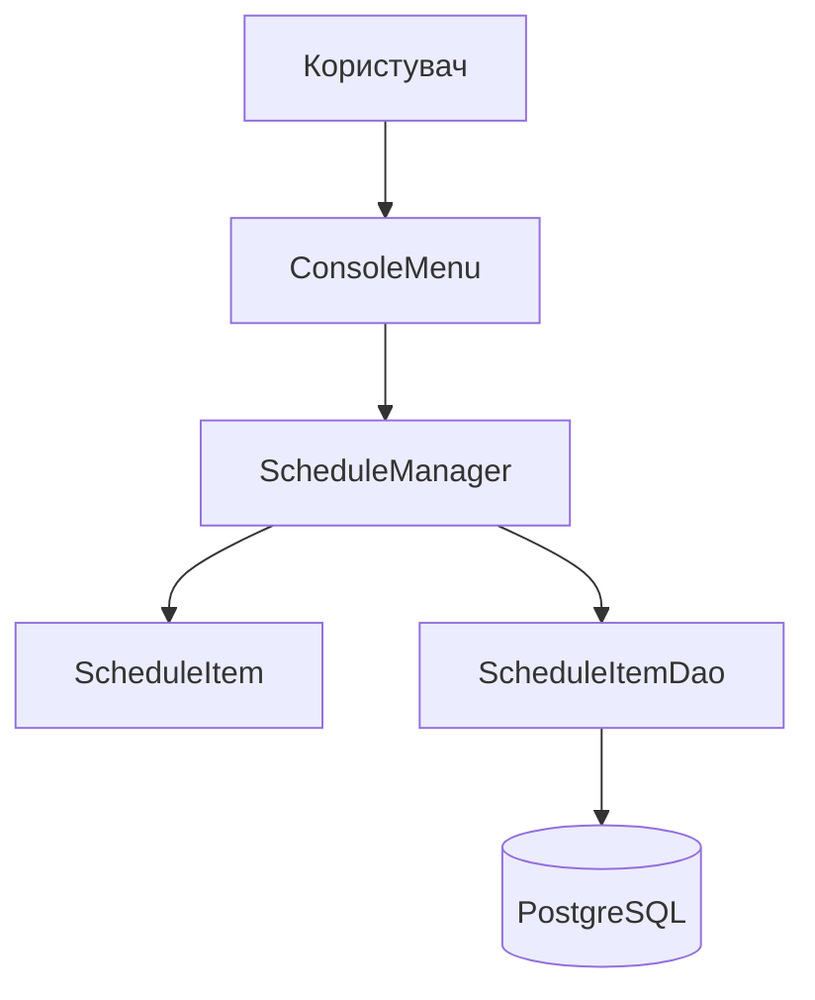
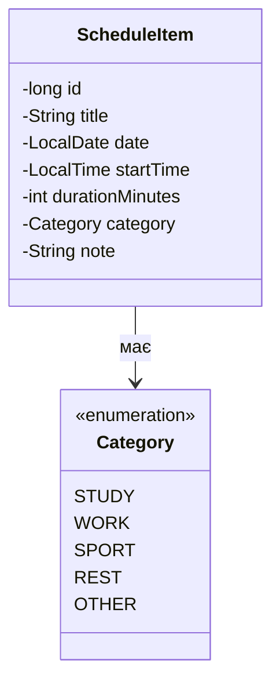
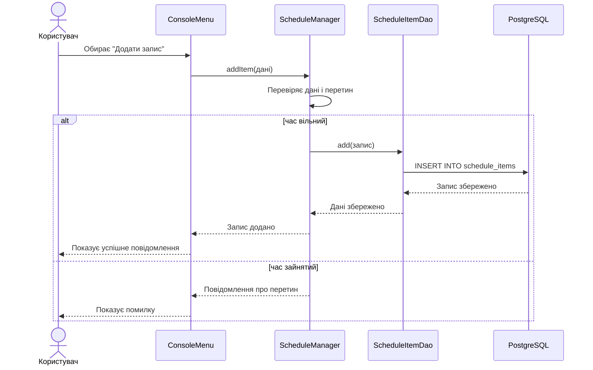

# SDD: PlanDay - програма для планування розкладу

## 1. Огляд і глосарій

**PlanDay** - це невелика консольна програма на Java для планування власного розкладу. У ній користувач може додати заняття або іншу справу, вказати день, час і тривалість, а потім подивитися план на вибраний день. Також можна змінити або видалити запис.

Головна мета першої версії - щоб користувач міг зберегти свій розклад в одному місці та випадково не поставив дві справи на один і той самий час.

Програма розрахована на одного користувача. Дані зберігаються у базі даних PostgreSQL, тому після закриття програми розклад не зникає.

**Поза межами першої версії:** авторизація, кілька користувачів, красивий графічний інтерфейс, нагадування, синхронізація з Google Calendar, розклад на місяць і спільний доступ до розкладу.

**Глосарій:**

| Термін | Значення |
|---|---|
| Розклад | Список запланованих занять або справ. |
| Запис розкладу | Одна справа в конкретний день і час. |
| Категорія | Тип запису: навчання, робота, спорт, відпочинок тощо. |
| Перетин | Ситуація, коли два записи мають спільний час. |
| Тривалість | Кількість хвилин, яку займає запис. |

## 2. Функціональні вимоги

| ID | User story | Пріоритет |
|---|---|---|
| US-1 | Як користувач, я хочу додати запис із назвою, днем, часом і тривалістю, щоб скласти свій розклад. | Must |
| US-2 | Як користувач, я хочу переглянути всі записи на обраний день, щоб знати свій план. | Must |
| US-3 | Як користувач, я хочу змінити запис, щоб виправити час або назву. | Must |
| US-4 | Як користувач, я хочу видалити запис, який уже не потрібен. | Must |
| US-5 | Як користувач, я хочу побачити повідомлення про перетин часу, щоб не запланувати дві справи одночасно. | Must |
| US-6 | Як користувач, я хочу вказати категорію запису, щоб розуміти тип справи. | Should |
| US-7 | Як користувач, я хочу переглянути розклад за весь тиждень, щоб бачити загальну картину. | Should |
| US-8 | Як користувач, я хочу відфільтрувати записи за категорією. | Could |
| US-9 | Як користувач, я хочу отримувати нагадування про початок справи. | Won't (this time) |

## 3. Нефункціональні вимоги

| ID | Категорія | Вимога |
|---|---|---|
| NFR-1 | Платформа | Програма має запускатися на комп'ютері, де встановлені Java 21 і Maven 3.9 або новіша версія Maven. |
| NFR-2 | Швидкість | Відкриття списку до 1000 записів має займати не більше 1 секунди. |
| NFR-3 | Збереження даних | Після закриття та повторного запуску програми раніше додані записи мають залишатися в базі даних PostgreSQL. |
| NFR-4 | Перевірка даних | Не можна зберегти запис без назви, з неправильним часом або з тривалістю 0 чи менше. |
| NFR-5 | Зручність | Усі пункти меню та повідомлення мають бути українською мовою. |
| NFR-6 | Надійність | Якщо користувач ввів неправильний пункт меню, програма не завершується з помилкою, а просить ввести дані ще раз. |

## 4. Архітектура програми

Програма буде консольною. Це означає, що користувач працює з нею через текстове меню. Такий варіант простіше реалізувати для навчального пет-проєкту на Java.



**Основні класи:**

- **`Main`** - запускає програму.
- **`ConsoleMenu`** - показує меню, читає введення користувача та виводить повідомлення.
- **`ScheduleManager`** - додає, шукає, змінює і видаляє записи; також перевіряє перетин часу.
- **`ScheduleItem`** - описує один запис у розкладі.
- **`Category`** - перелік можливих категорій запису.
- **`ScheduleItemDao`** - виконує SQL-запити: додає, читає, змінює та видаляє записи в базі даних.
- **`DatabaseConnection`** - створює з'єднання з PostgreSQL через JDBC.

Усі ці класи будуть в одному Java-проєкті. Для роботи з PostgreSQL буде використано JDBC-драйвер. Maven буде відповідати за залежності, збірку та запуск програми. У файлі `pom.xml` будуть вказані Java 21, JDBC-драйвер PostgreSQL і плагін для запуску. Вебсервер для першої версії не потрібен.

## 5. Модель даних

Основна таблиця бази даних - `schedule_items`. Один рядок у ній відповідає одному об'єкту `ScheduleItem` у Java.



| Поле | Тип | Опис |
|---|---|---|
| `id` | `long` | Унікальний номер запису. Потрібний для редагування і видалення. |
| `title` | `String` | Назва справи, наприклад «Пара з Java». |
| `date` | `LocalDate` | Дата, на яку запланована справа. У базі даних це поле має назву `planned_date`. |
| `startTime` | `LocalTime` | Час початку. |
| `durationMinutes` | `int` | Тривалість у хвилинах. |
| `category` | `Category` | Категорія справи. |
| `note` | `String` | Необов'язковий короткий коментар. |

Приклад SQL-таблиці:

```sql
CREATE TABLE schedule_items (
    id BIGSERIAL PRIMARY KEY,
    title VARCHAR(100) NOT NULL,
    planned_date DATE NOT NULL,
    start_time TIME NOT NULL,
    duration_minutes INTEGER NOT NULL,
    category VARCHAR(20) NOT NULL,
    note VARCHAR(250)
);
```

Поля в таблиці мають майже такі самі назви, як і поля в класі `ScheduleItem`, щоб було простіше з ними працювати.

## 6. Головні сценарії

### 6.1. Додавання запису

1. Користувач у меню обирає пункт «Додати запис».
2. Програма просить ввести назву, дату, час, тривалість, категорію і за бажанням примітку.
3. `ScheduleManager` перевіряє, чи правильно введені дані.
4. Програма шукає записи на цю дату й перевіряє, чи немає перетину часу.
5. Якщо перетину немає, запис додається у базу даних.
6. Якщо час зайнятий, програма показує повідомлення і нічого не зберігає.



### 6.2. Перегляд розкладу на день

1. Користувач обирає пункт «Показати розклад на день».
2. Вводить дату.
3. Програма знаходить усі записи з такою датою.
4. Записи сортуються за часом початку.
5. Програма виводить їх у консоль. Якщо записів немає, показує повідомлення «На цей день справ немає».

### 6.3. Видалення запису

1. Користувач переглядає розклад і вводить `id` запису.
2. Програма шукає запис з таким номером.
3. Якщо запис знайдено, він видаляється з бази даних.
4. Якщо такого номера немає, програма показує повідомлення про помилку.

## 7. Меню програми

Приклад головного меню:

```text
1 - Додати запис
2 - Показати розклад на день
3 - Показати розклад на тиждень
4 - Змінити запис
5 - Видалити запис
0 - Вийти з програми
```

Зміни зберігаються у базі даних одразу після додавання, редагування або видалення, тому під час виходу нічого окремо зберігати не потрібно.

## 8. Запуск через Maven

Проєкт буде Maven-проєктом. Основні команди для роботи:

```text
mvn clean package  - зібрати проєкт
mvn exec:java      - запустити консольну програму
```

Перед запуском треба встановити Java 21, Maven і PostgreSQL, а також створити базу даних `plan_day`.

## 9. Перевірка перетину часу

Два записи перетинаються, якщо вони мають однакову дату і час одного з них потрапляє в проміжок іншого. Наприклад:

- «Пара з Java» з 10:00 до 11:30;
- «Спорт» з 11:00 до 12:00.

Ці записи перетинаються, тому другий запис додати не можна. Але запис о 11:30 можна додати, бо він починається тоді, коли перший уже закінчується.

Для перевірки у `ScheduleManager` можна порівняти час початку й закінчення нового запису з кожним записом того самого дня.

## 10. Ризики та прості рішення

| Ризик | Як будемо вирішувати |
|---|---|
| Користувач вводить дату або час не в тому форматі | Пояснити потрібний формат, наприклад `2026-10-26` і `10:30`, та попросити повторити введення. |
| Немає з'єднання з базою даних | Показати зрозуміле повідомлення: перевірити, чи запущений PostgreSQL та чи правильні дані підключення. |
| Не працює перевірка перетину | Перевірити вручну випадки: повний перетин, частковий перетин, запис до іншого і запис після іншого. |
| Неправильний SQL-запит | Перевіряти запити на невеликій тестовій базі та виводити текст помилки в консоль. |

## 11. Що можна додати пізніше

- графічний інтерфейс на JavaFX;
- фільтр за категоріями;
- нагадування перед початком справи;
- кольорове відображення різних категорій;
- окремі розклади для кількох користувачів.


