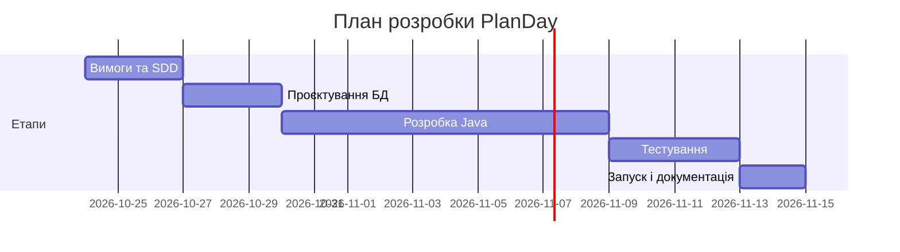

# SDLC: PlanDay - програма для планування розкладу

## 1. Ідея продукту

**PlanDay** - це невелика консольна програма на Java. Вона допомагає користувачу записувати заняття, роботу, спорт або інші справи у свій розклад. Для кожного запису вказується назва, дата, час, тривалість і категорія. Дані зберігаються в базі даних PostgreSQL.

Користувач може додати запис, подивитися розклад на день або тиждень, змінити та видалити запис. Також програма перевіряє, щоб дві справи не накладалися одна на одну за часом.

**Цільова аудиторія:** студенти, яким потрібно тримати в одному місці пари, домашні завдання, роботу та особисті справи.

**Проблема:** коли розклад записаний у різних нотатках або не записаний взагалі, легко забути про справу чи запланувати дві справи на однаковий час.

## 2. Обрана методологія

**Методологія: Kanban.**

Для цього проєкту буде достатньо простої дошки з трьома колонками:

```text
To Do → In Progress → Done
```

Наприклад, спочатку задачу «Створити таблицю PostgreSQL» можна помістити в `To Do`. Під час роботи вона переходить у `In Progress`, а після перевірки - у `Done`.

Kanban підходить, бо проєкт невеликий і його робить один студент. Не потрібно проводити спринти, зустрічі або ділити роботу на великі етапи, як у Scrum. Задачі можна виконувати по черзі та бачити прогрес.

## 3. Фази життєвого циклу

### 3.1. Requirements - збір вимог

| | |
|---|---|
| **Вхідні дані** | Ідея програми для планування розкладу. |
| **Що робимо** | Визначаємо основні функції: додавання, перегляд, редагування, видалення записів і перевірку перетинів. |
| **Результат** | Список user stories та функціональних вимог у `SDD.md`. |
| **Коли етап завершено** | Зрозуміло, що обов'язково має працювати в першій версії. |

### 3.2. Design - проєктування

| | |
|---|---|
| **Вхідні дані** | Список функцій програми. |
| **Що робимо** | Обираємо Java, консольне меню, PostgreSQL і JDBC. Продумуємо класи та таблицю `schedule_items`. |
| **Результат** | Опис класів, схема даних і сценарії роботи в `SDD.md`. |
| **Коли етап завершено** | Зрозуміло, які класи треба створити і які поля будуть у таблиці. |

### 3.3. Implementation - розробка

| | |
|---|---|
| **Вхідні дані** | SDD, схема таблиці та список задач на Kanban-дошці. |
| **Що робимо** | Створюємо Java-проєкт, підключаємо PostgreSQL через JDBC, пишемо класи `ScheduleItem`, `ScheduleManager`, `ScheduleItemDao`, `DatabaseConnection` і `ConsoleMenu`. |
| **Результат** | Працююча консольна програма та SQL-скрипт для створення таблиці. |
| **Коли етап завершено** | Можна додати, переглянути, змінити та видалити запис через меню. |

### 3.4. Testing - тестування

| | |
|---|---|
| **Вхідні дані** | Працююча програма з тестовою базою даних. |
| **Що робимо** | Вручну перевіряємо всі пункти меню, правильність введення, SQL-запити та перевірку перетину часу. |
| **Результат** | Список пройдених перевірок і виправлені помилки. |
| **Коли етап завершено** | Основні сценарії працюють, програма не завершується через неправильне введення. |

### 3.5. Deployment - запуск

| | |
|---|---|
| **Вхідні дані** | Перевірений код та створена база даних. |
| **Що робимо** | Налаштовуємо PostgreSQL на локальному комп'ютері, створюємо таблицю за SQL-скриптом і запускаємо програму. |
| **Результат** | Програму можна запустити на комп'ютері з Java та PostgreSQL. |
| **Коли етап завершено** | Користувач може відкрити меню та зберегти тестовий запис у базу. |

### 3.6. Maintenance - підтримка

| | |
|---|---|
| **Вхідні дані** | Запущена версія програми та знайдені помилки. |
| **Що робимо** | Виправляємо помилки, додаємо невеликі покращення та записуємо ідеї для наступної версії. |
| **Результат** | Оновлення коду та список майбутніх функцій. |
| **Коли етап завершено** | Це постійний етап: він триває, поки програму потрібно оновлювати. |

## 4. План розробки

| № | Задача | Результат |
|---|---|---|
| 1 | Створити репозиторій і Java-проєкт | Є структура папок і файл `Main.java`. |
| 2 | Встановити PostgreSQL та створити базу даних | Є база `plan_day`. |
| 3 | Створити таблицю `schedule_items` | У таблиці є поля для запису розкладу. |
| 4 | Додати JDBC-драйвер і клас `DatabaseConnection` | Java може підключитися до PostgreSQL. |
| 5 | Створити клас `ScheduleItem` та `Category` | Описаний один запис розкладу. |
| 6 | Реалізувати `ScheduleItemDao` | Працюють SQL-запити для додавання, читання, зміни та видалення. |
| 7 | Реалізувати `ScheduleManager` | Є перевірка даних і перетину часу. |
| 8 | Реалізувати консольне меню | Користувач може обрати потрібну дію. |
| 9 | Протестувати програму вручну | Основні помилки знайдені й виправлені. |
| 10 | Оновити документацію | `SDD.md` і `SDLC.md` відповідають програмі. |

## 5. Definition of Done

Проєкт можна вважати готовим для першої версії, коли виконані такі умови:

- [ ] Створена база даних PostgreSQL і таблиця `schedule_items`.
- [ ] Програма підключається до бази через JDBC.
- [ ] Можна додати запис із назвою, датою, часом, тривалістю і категорією.
- [ ] Можна переглянути записи на обраний день.
- [ ] Можна змінити і видалити запис за його `id`.
- [ ] Програма не дозволяє створити два записи, що перетинаються за часом.
- [ ] Неправильне введення не завершує програму з помилкою.
- [ ] Основні сценарії перевірені вручну.
- [ ] У репозиторії є `SDD.md`, `SDLC.md` і файл з SQL-скриптом.

## 6. План тестування

| № | Що перевіряємо | Очікуваний результат |
|---|---|---|
| T-1 | Додати запис із правильними даними | Запис з'являється в базі й показується в розкладі. |
| T-2 | Додати запис без назви | Програма просить ввести назву ще раз. |
| T-3 | Ввести неправильну дату, наприклад `26.10.2026` | Програма пояснює, що дата має бути у форматі `2026-10-26`. |
| T-4 | Додати запис, який перетинається з іншим | Програма показує повідомлення, запис не додається. |
| T-5 | Показати розклад на день без записів | Виводиться повідомлення, що справ немає. |
| T-6 | Змінити назву або час запису | Дані оновлюються в базі. |
| T-7 | Видалити запис за правильним `id` | Запис зникає з бази та зі списку. |
| T-8 | Видалити запис із неіснуючим `id` | Програма показує зрозуміле повідомлення про помилку. |

## 7. Таймлайн



Терміни приблизні. Якщо якась задача, наприклад підключення до PostgreSQL, займе більше часу, наступні задачі можна посунути.

## 8. Ролі та комунікація

Над проєктом працює один студент, тому він виконує основні ролі самостійно.

| Роль | Відповідальність |
|---|---|
| Розробник | Пише Java-код, створює класи та SQL-запити. |
| Тестувальник | Перевіряє меню й основні сценарії вручну. |
| Користувач | Пробує програму та може запропонувати, що зробити зрозуміліше. |

Задачі зберігаються на Kanban-дошці. Помилки та нові ідеї можна додавати як Issues у GitHub-репозиторії.

## 9. Що можна зробити в наступній версії

- додати графічний інтерфейс на JavaFX;
- зробити фільтр за категорією;
- додати нагадування про початок справи;
- зробити окремі розклади для різних користувачів;
- додати пошук за назвою запису.


